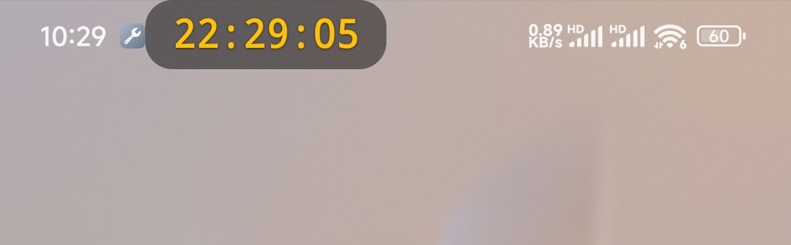
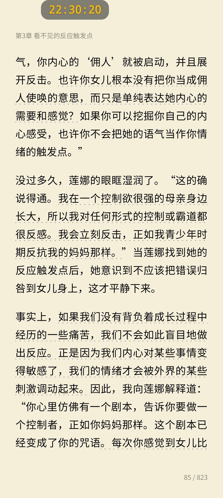
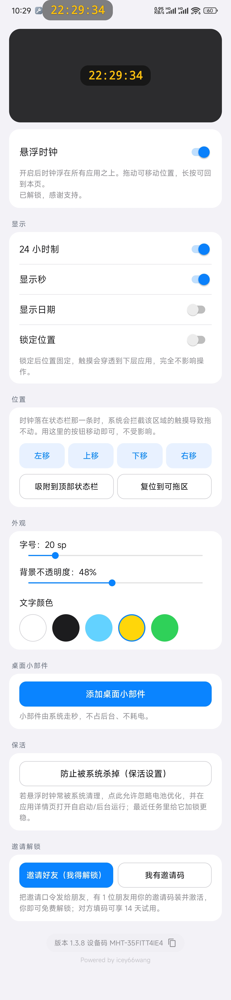

# 手机上加一个带秒的悬浮时钟，看时间不用再退出应用

刷视频、打游戏、看电子书或上网课时，想看一眼时间，通常要退出当前页面，或者下拉状态栏。

如果你需要随时看到精确到秒的时间，可以试试「icey 悬浮时钟」。

它会把一个简洁的数字时钟浮在其他应用上层。无论是在看视频、玩游戏，还是使用微信读书，都不用退出当前应用，抬眼就能看到时间。

## 它能做什么？

- 支持 24 小时制、显示秒和日期
- 悬浮时钟位置可以自由拖动
- 支持锁定位置，锁定后触摸可以穿透，不影响下层应用操作
- 可以调节字号、文字颜色和背景透明度
- 支持白、黑、青、琥珀、绿等多种文字颜色
- 提供桌面数字时钟小部件，系统走秒，不占后台，永久免费
- 针对部分国产手机提供保活设置引导，减少应用被系统清理的情况

它适合这些场景：

看直播时随时掌握时间，打游戏时不退出全屏画面也能看时间，阅读或上网课时查看学习进度，做倒计时或需要精确到秒的工作。

【icey悬浮时钟邀请】邀请码 MHT-35FITT4IE4，复制这段话后打开 App 会自动填写，可享 14 天试用。下载：https://money-3jg.pages.dev/apps/floating-clock/

